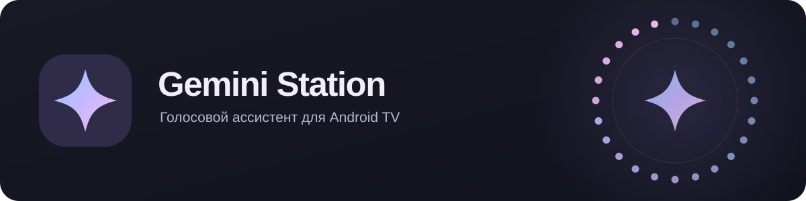

<div align="center">
  

  # Gemini Station

  Инструмент для подключения Gemini к Android TV и Яндекс Станции Макс.

  [Установка](#установка) · [ADB и плагины](#adb-и-плагины) · [Руководство](docs/TECHNICAL.md)
</div>

---

> **Экспериментальный проект.** Это не полная замена Алисы. Диалог и вызов кнопкой проверялись в предыдущих версиях; голосовая активация и прямой вывод на экран и кольцо требуют проверки на устройстве. Работа зависит от прошивки, микрофона, сети и доступа к Gemini API.

## Возможности

- **Голосовой диалог:** Gemini Live для распознавания, Gemini API для ответа, Gemini TTS или Android TTS для озвучки; текст отображается в оверлее.
- **Локальная активация:** две экспериментальные модели microWakeWord, чувствительность, фильтры и необязательные личные образцы. По умолчанию активация выключена.
- **Веб-панель:** настройки модели и голоса, DNS, промпта, журнала, необязательного пароля и импорта/экспорта части настроек. Работает и на телефоне.
- **Действия:** приложения, громкость, медиакнопки и поиск YouTube; экспериментальные Яндекс Музыка и умный дом.
- **Экран и кольцо:** анимации и свои GIF для экрана; экспериментальное прямое управление экраном и кольцом через root по умолчанию выключено и на станции не проверено.

Приложению не нужен домашний сервер, но распознавание команды и Gemini API требуют интернета. Результат некоторых команд зависит от прошивки и сторонних приложений.

## Установка

1. Откройте [GitHub Actions](https://github.com/RubCut/GeminiStation/actions/workflows/android.yml), выберите успешную сборку нужной ветки и скачайте артефакт `GeminiStation-debug`. Для скачивания может потребоваться вход в GitHub; артефакты доступны ограниченное время.
2. Распакуйте и установите `app-debug.apk` на устройство с Android TV 9+, запустите приложение и разрешите микрофон. При обновлении подпись APK должна совпадать с установленной версией.
3. С телефона или компьютера в той же сети откройте **`http://<IP-станции>:6529`**. В разделе «Ассистент» добавьте ключ из [Google AI Studio](https://aistudio.google.com/apikey).
4. Вызовите ассистента доступным способом, дождитесь сигнала и надписи «Слушаю…», затем произнесите команду. Речь во время сигнала сейчас не записывается. Голосовую активацию при необходимости включите отдельно в панели.

Пример установки и вызова через ADB, когда APK находится в текущем каталоге:

```sh
adb install -r app-debug.apk
adb shell am start -a android.intent.action.ASSIST -n ru.geministation/.MainActivity
```

Подробности об установке, подписи сборки, кнопке пульта и диагностике — в [руководстве](docs/TECHNICAL.md).

## ADB и плагины

**ADB Helper** — отдельный APK `ButtonHelper-debug`, который запускается через ADB с правами Android **shell**, не root. Он может обрабатывать кнопку пульта и предоставлять внутреннему коду приложения защищённый локальный канал для shell-команд. Веб-панель и Gemini не получают прямой произвольный shell-доступ. Для работы нужны совместимые debug-сборки с одинаковой подписью; обновлённый помощник ещё нужно проверить на станции. Команды запуска и ограничения: [ADB Helper в руководстве](docs/TECHNICAL.md#эксперимент-adb-helper-и-обработчик-пульта).

**Python-плагины** расширяют набор инструментов ассистента. Для них нужен отдельный APK `PluginRunner-debug` с той же подписью. ZIP с `plugin.json` и `plugin.py` загружается через панель и подтверждается на станции. Доступ к ADB shell запрашивается **конкретным плагином** и подтверждается на станции при его установке; после этого отдельного подтверждения каждой команды нет. Для shell нужен запущенный ADB Helper. Gemini может вызывать заявленные плагином инструменты. Плагин — исполняемый Python-код с доступом к сети, поэтому устанавливайте только доверенные архивы. [Формат и ограничения](docs/TECHNICAL.md#python-плагины-экспериментально) · [Пример плагина](examples/python-plugin/).

## Безопасность

- Панель доступна по **HTTP** и по умолчанию без пароля. Пароль можно включить, но он не шифрует соединение. Используйте доверенную сеть и не открывайте порт 6529 в интернет; отдельного восстановления забытого пароля пока нет.
- Фоновая активация обрабатывается локально; после срабатывания звук отправляется в Gemini Live. В Gemini также передаются запросы, список доступных приложений и, при включённом умном доме, сведения о разрешённых устройствах и комнатах.
- Не публикуйте ключи, токены, QR-коды или логи с личными данными. Экспорт не включает секреты, личные образцы, плагины и настройки умного дома, экрана и кольца; пользовательский промпт в файле может содержать личный текст.
- Личные образцы не подтверждают личность и не гарантируют защиту от ложных срабатываний. Root-режимы могут конфликтовать с прошивкой; работа на конкретном устройстве не гарантирована.

Если что-то не работает, проверьте разрешение микрофона, статус активации и **«Журнал»** в панели. Перед отправкой журнала удалите личные сведения и секреты.

## Документация

[Подробное руководство](docs/TECHNICAL.md) · [Тестер кнопок](keytester/README.md) · [microWakeWord](experiments/microwakeword/README.md) · [Обзор кода](CODE_REVIEW.md) · [Сторонние компоненты](THIRD_PARTY_NOTICES.md)

Код проекта — [MIT](LICENSE). Права на некоторые TTS-источники экспериментальных моделей, включая датасет Irina, не выяснены; перед дальнейшим распространением проверьте уведомления о сторонних компонентах. Проект не является официальным продуктом Google или Яндекса.
