# Скриншоты веб-панели

[← Вернуться к README](../README.md)

Снимки показывают текущий интерфейс на компьютере (1365 × 900) и телефоне (390 × 844). На них видимая область вкладки; остальное доступно прокруткой.

**Это демонстрация с тестовыми данными**, а не снимки реальной станции: состояние подключения, пример плагина и записи журнала имитированы. Ключей, токенов и личных данных на снимках нет.

[Компьютер](#компьютер) · [Телефон](#телефон)

## Компьютер

### Обзор

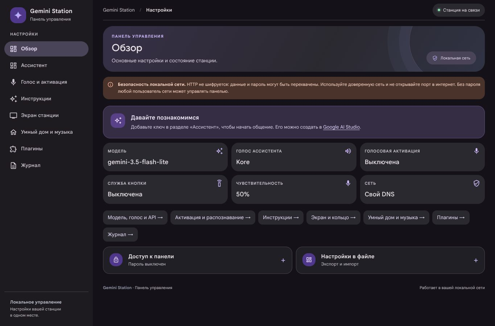

### Ассистент

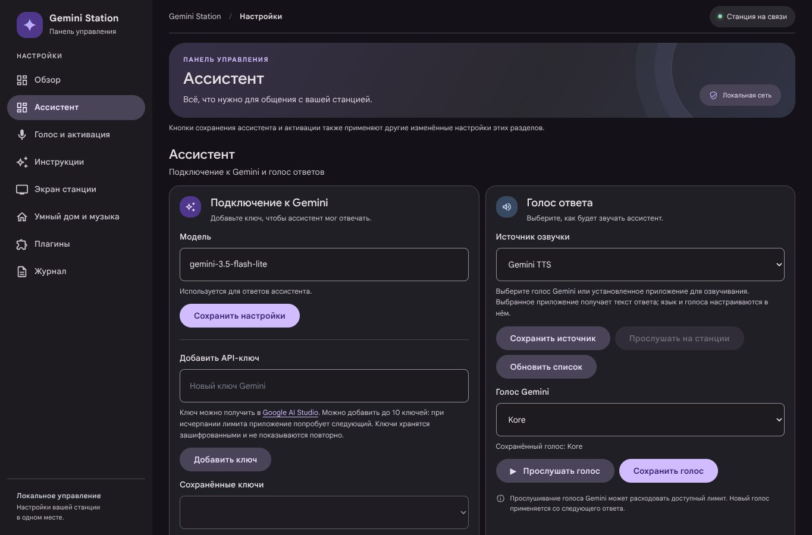

### Голос и активация

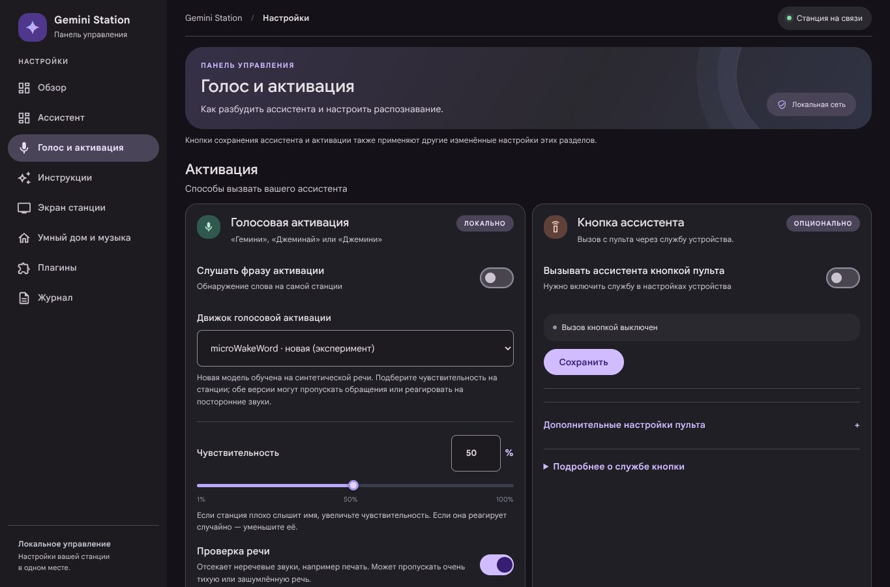

### Инструкции

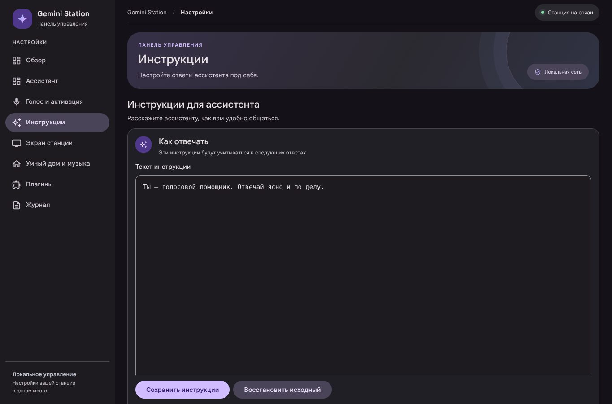

### Экран станции

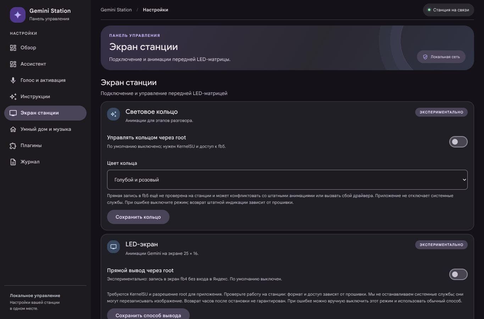

### Умный дом и музыка

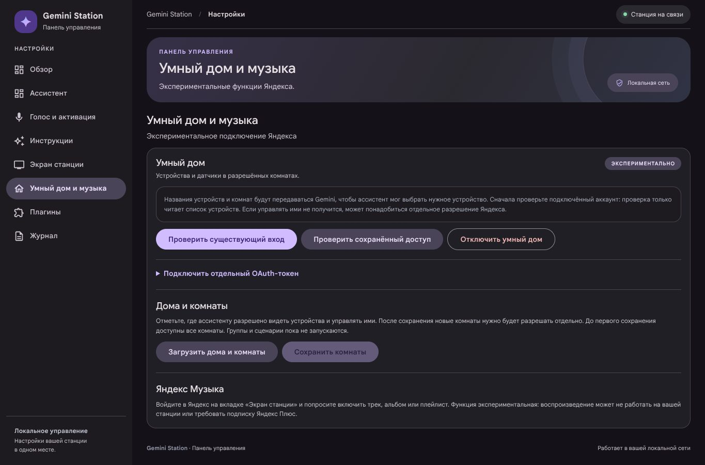

### Плагины

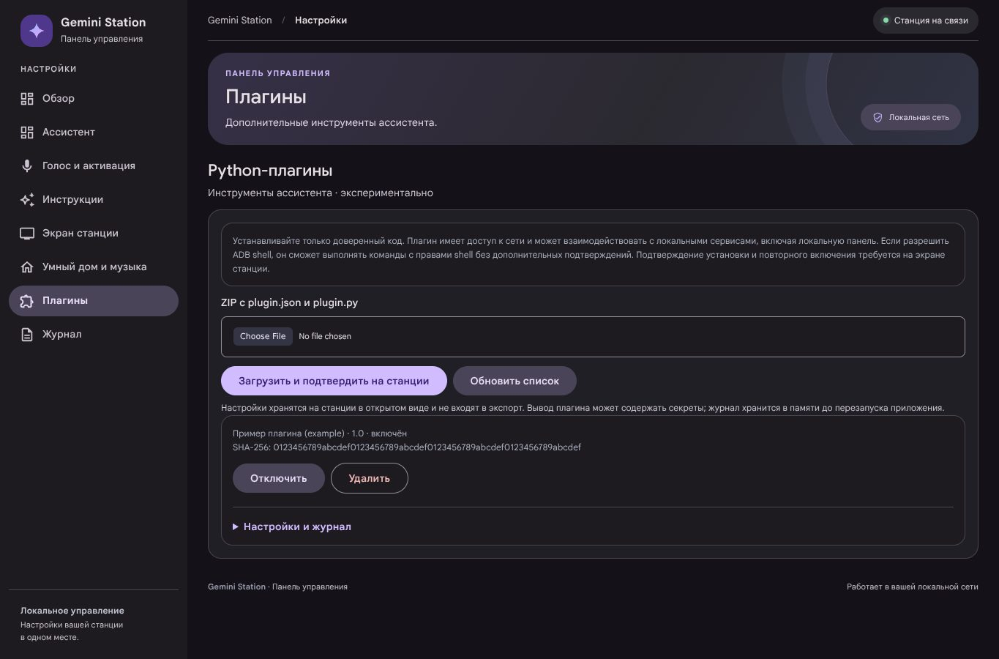

Настройки и журнал примера плагина:

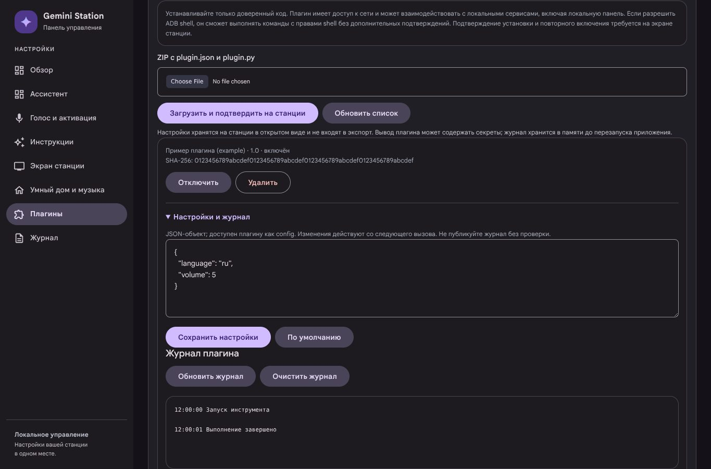

### Журнал

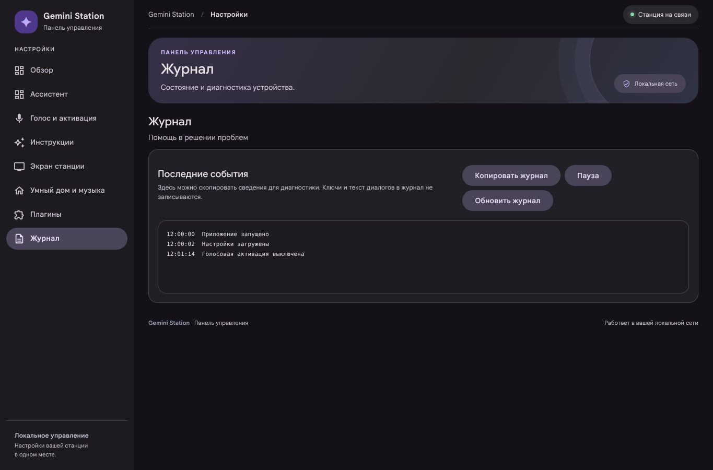

## Телефон

### Обзор

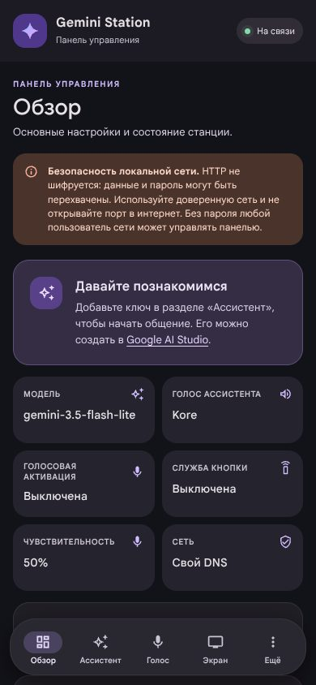

### Ассистент

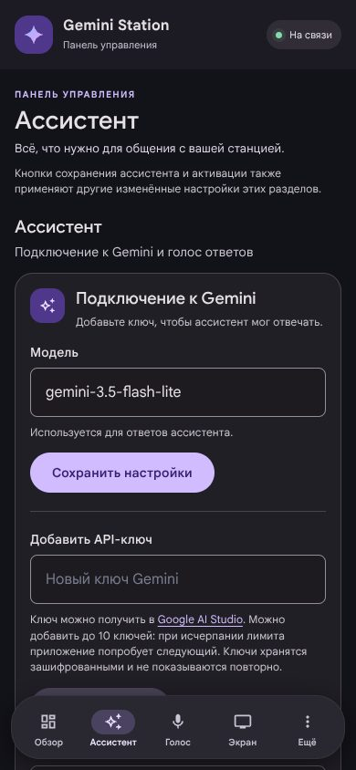

### Голос и активация

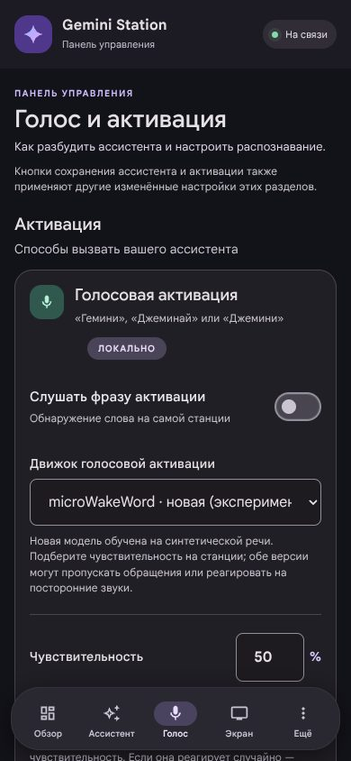

### Инструкции

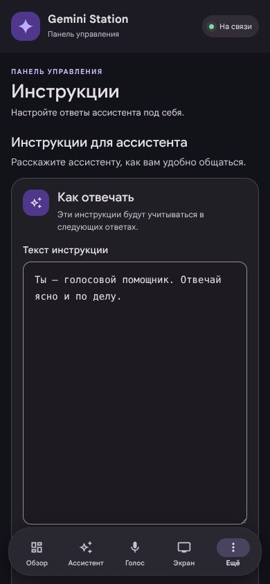

### Экран станции

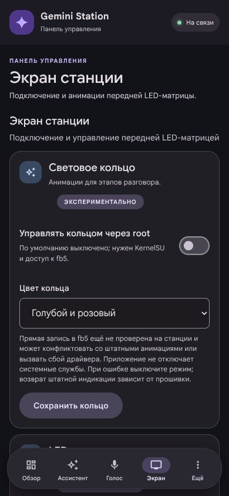

### Умный дом и музыка

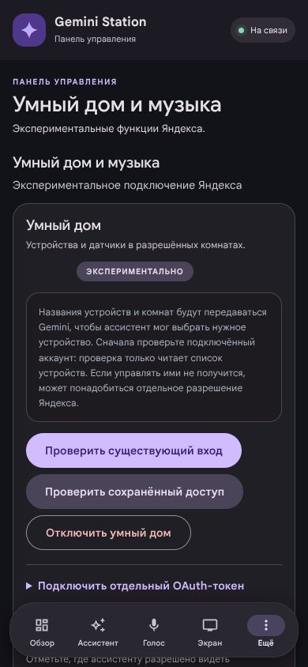

### Плагины

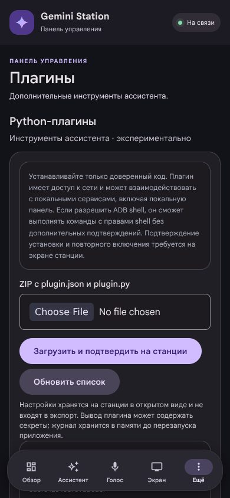

Настройки и журнал примера плагина:

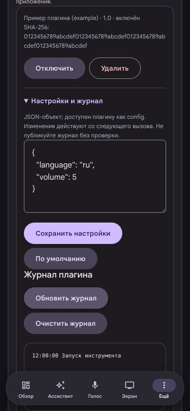

### Журнал

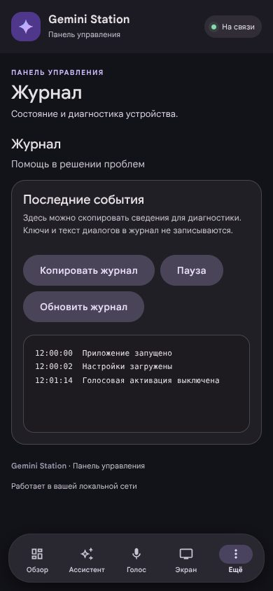

[↑ К началу](#скриншоты-веб-панели) · [README](../README.md)

## Обновить снимки

Скрипт [`tools/capture_panel_screenshots.js`](../tools/capture_panel_screenshots.js) открывает актуальный HTML панели с локальными тестовыми ответами; к станции и внешним сервисам он не подключается. Для запуска нужны Node.js, `playwright-core` и `@sparticuz/chromium`, например:

```sh
npm install --prefix /tmp/gemini-screenshots playwright-core@1.58.2 @sparticuz/chromium@143.0.0
NODE_PATH=/tmp/gemini-screenshots/node_modules node tools/capture_panel_screenshots.js
```

Сборке Chromium могут потребоваться системные библиотеки Linux. Проверьте готовые изображения перед публикацией и не подставляйте реальные ключи или журналы.
