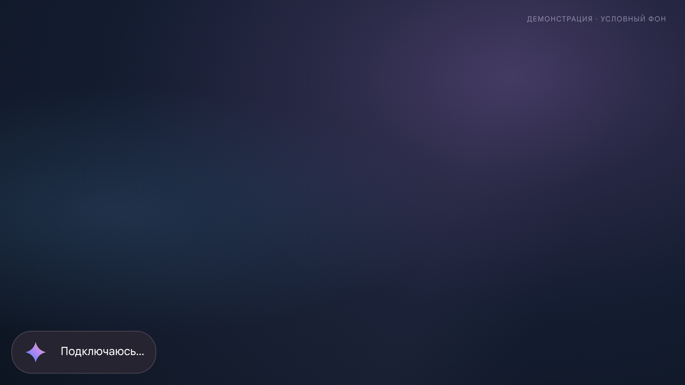
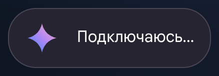
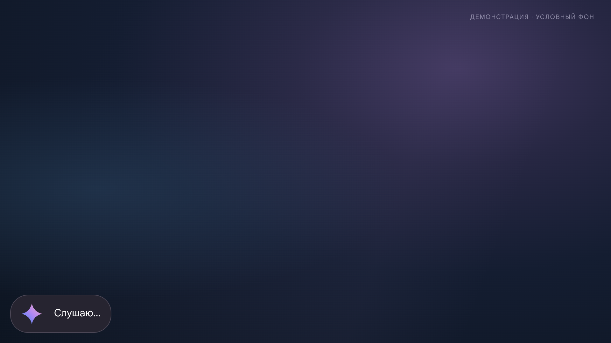
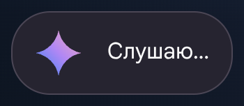
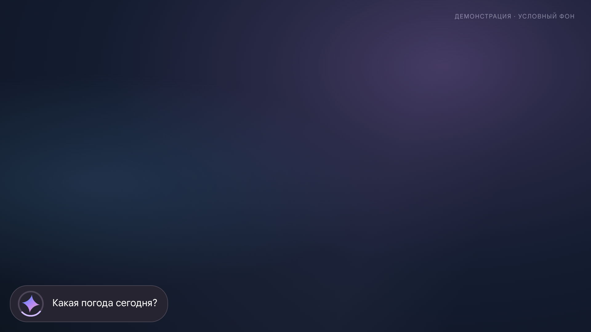
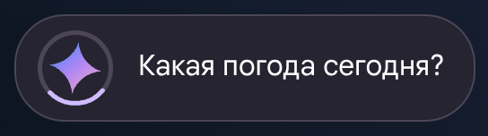
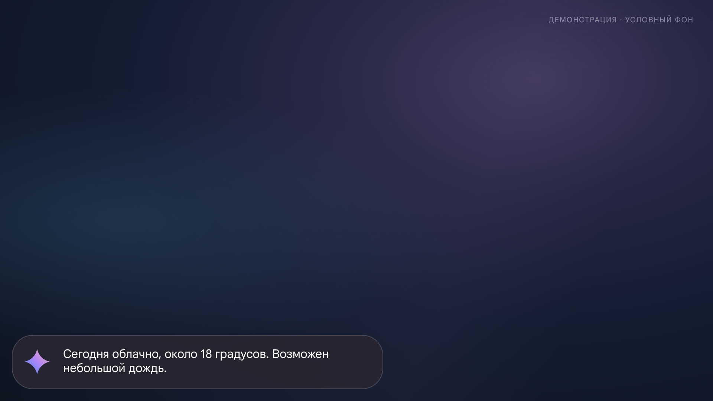
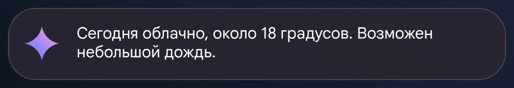

# Оверлей Gemini на экране ТВ

[← Галерея веб-панели](SCREENSHOTS.md) · [README](../README.md)

**Это демонстрационный макет, а не скриншоты со станции.** Он воспроизводит текущий код `MainActivity` и `ThinkingIndicator`: прозрачное окно внизу слева, шрифт Google Sans, логотип и индикатор. Фон и фраза о погоде условные. На реальном устройстве размеры, перенос текста, системные отступы и внешний вид могут отличаться; анимация на этих снимках остановлена.

В примере показан экран 1920 × 1080, с условной плотностью 2 px/dp. Крупные фрагменты — вырезки тех же изображений.

## Подключение





## Слушаю





## Размышление

Во время обработки показан распознанный запрос; вокруг логотипа вращается индикатор. На снимке — один условный кадр.





## Ответ





На станции оверлей отображается поверх текущего содержимого ТВ без искусственного фона с этих картинок. Физическую проверку необходимо выполнить отдельно.

## Обновить макеты

Скрипт [`tools/capture_tv_mock.js`](../tools/capture_tv_mock.js) рисует независимый HTML-макет по значениям из исходного кода, **не запускает Android-приложение**. При изменении Android UI его нужно вручную сверить и обновить. Требуются Node.js, `playwright-core` и `@sparticuz/chromium`, как описано в [галерее веб-панели](SCREENSHOTS.md#обновить-снимки):

```sh
NODE_PATH=/tmp/gemini-screenshots/node_modules node tools/capture_tv_mock.js
```
