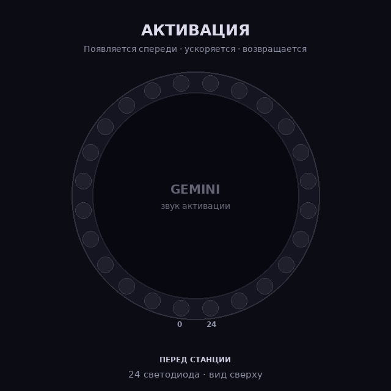
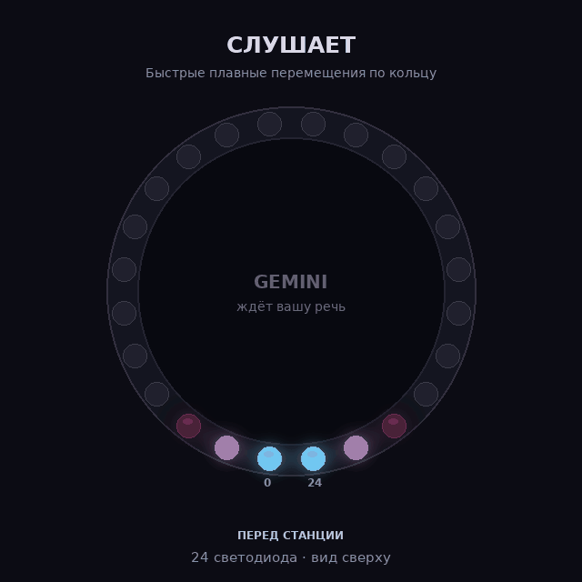
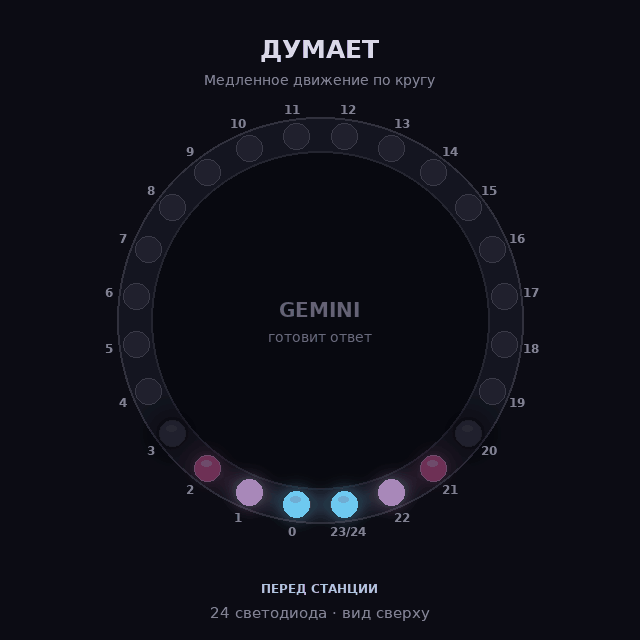
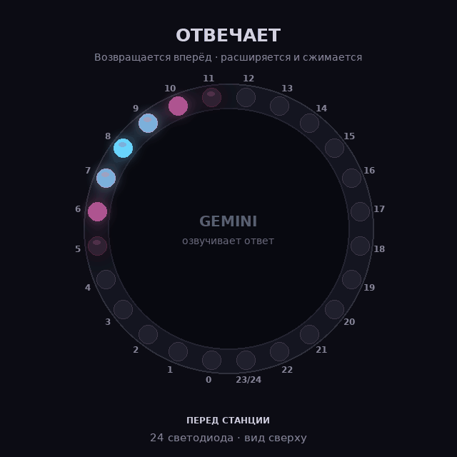

# Анимации кольца — предварительный просмотр

Четыре визуальных макета, вид сверху. Передняя часть станции находится внизу, соседние передние светодиоды отмечены 0 и 23/24. Здесь 24 физических светодиода: индексы 0–23; отметка «23/24» дополнительно показывает ваш ориентир 24. Фактическое соответствие номеров на станции ещё не проверено. Это не запись со станции: яркость и реальные переходы необходимо будет проверить на устройстве.

## Активация
Линия появляется спереди, ускоряется по кругу втрое быстрее прежнего макета и возвращается на переднюю часть.

[Открыть или скачать GIF](01-activation.gif)

## Слушает
Линия быстро и плавно перемещается между разными точками кольца.

[Открыть или скачать GIF](02-listening.gif)

## Думает
Линия движется по кругу вдвое быстрее прежнего макета.

[Открыть или скачать GIF](03-thinking.gif)

## Отвечает
Линия возвращается вперёд, расширяется и сжимается, до следующего состояния диалога.

[Открыть или скачать GIF](04-speaking.gif)
